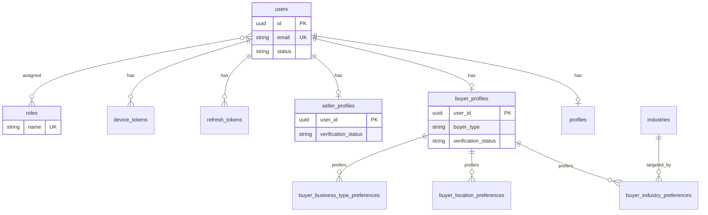
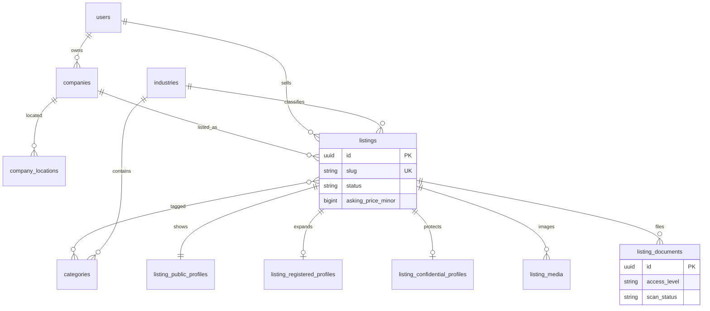
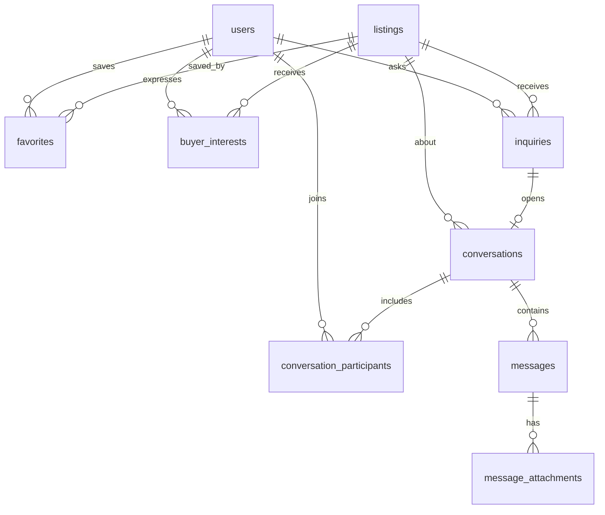
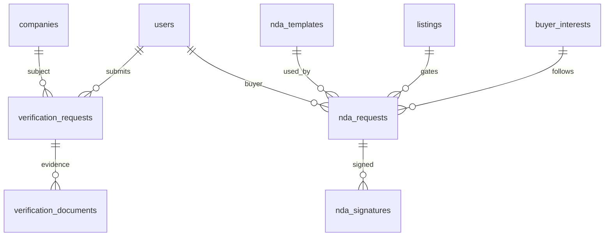
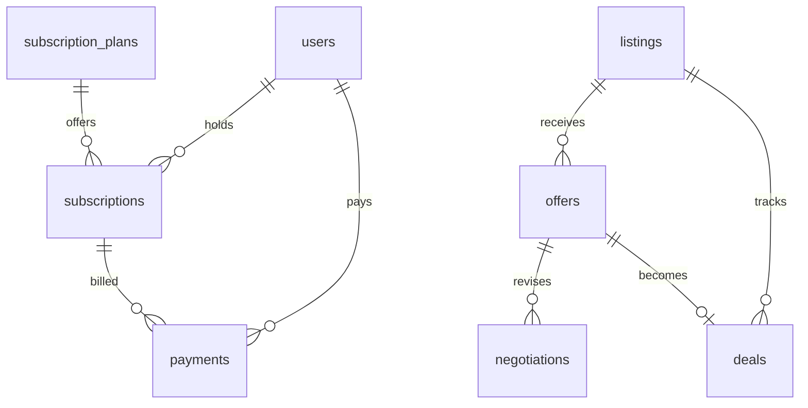

# 2. Database ER diagram

UUIDs mark entities clients can address. Crow's-foot is shown in Mermaid. Log tables (`listing_views`, `audit_logs`, `document_access_logs`) are append-only and omitted from the diagrams for readability. Phase 8 deal tables are in the last diagram.

## Identity and profiles

## Companies and listings

## Interest, inquiry, messages

## Verification and NDA

## Commerce and deals (later phases)

## Visibility dependency

Confidential profile rows and `access_level = confidential` documents are readable only when an `nda_requests` row for that listing and buyer is `active`, or the caller is the selling user, or the caller is staff. That rule is enforced in policies, not by a database grant.
