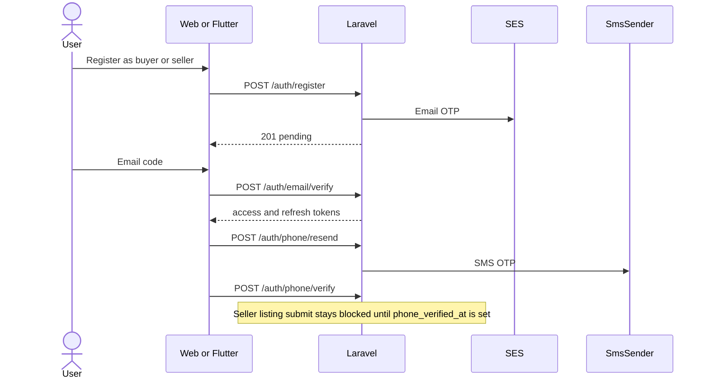
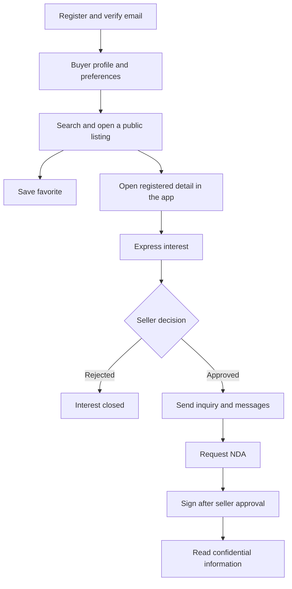
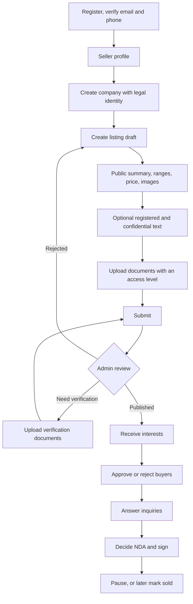
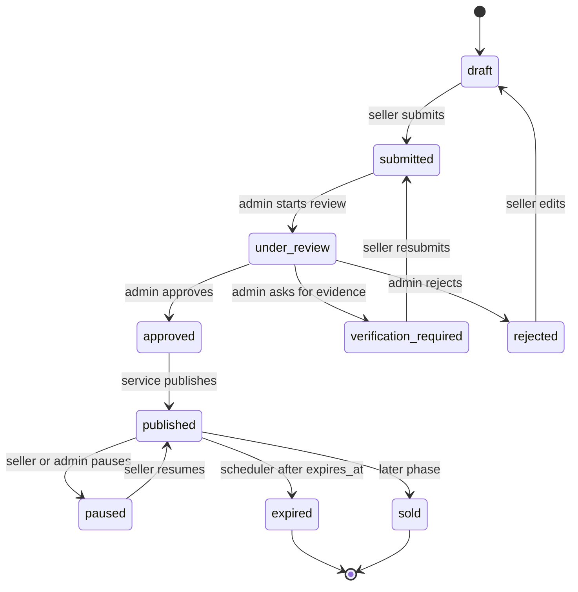
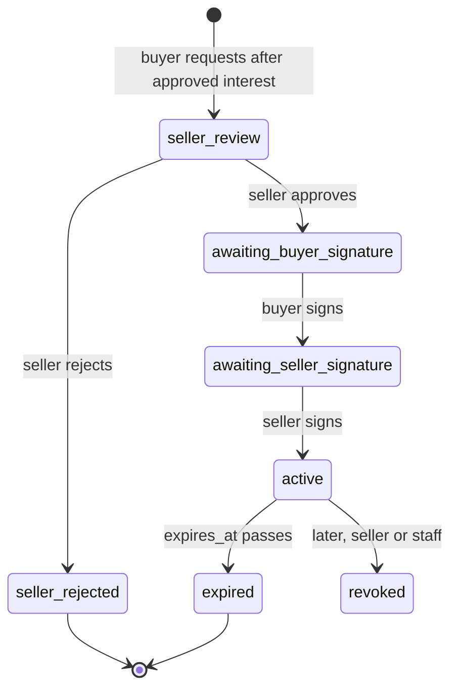
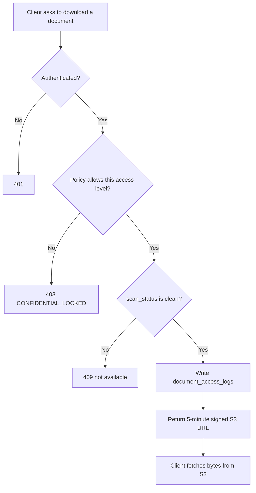

# 9–14. Flows

Statuses are the database values. Clients display them in uppercase labels.

## 9. Authentication

Login loads the user, checks `status` is `active`, verifies the password, writes an auth audit row, and returns a 15-minute access token plus a 30-day refresh token. Refresh revokes the presented refresh token and issues a new pair. Reuse of a revoked refresh token revokes the whole rotation chain for that device.

Logout revokes the current refresh token and the Sanctum access token.

Password reset always responds 200 on the request step so accounts cannot be enumerated. The code is hashed. Five bad attempts burn it.

Staff login is Filament, not `/api/v1/auth/login`. Staff without confirmed TOTP cannot open the panel.

## 10. Buyer

A buyer does not message a seller until an inquiry exists. An NDA cannot be requested until the interest is `approved`. The buyer never receives the seller's email or phone.

## 11. Seller

Legal name and street address are stored on the company and are not copied into the public listing resource.

## 12. Listing approval

Public `GET /listings` returns rows in `published` or `under_offer` only. `under_offer` is unused until phase 8. `approved` is transient inside the approve transaction so clients rarely observe it.

`expires_at` is set to 90 days after publish in the MVP. The scheduler moves due rows to `expired` and notifies the seller.

## 13. NDA

On the transition to `active`, `NdaActivated` is dispatched. Listeners notify both parties. Confidential resources start including data on the next request. No cache of a public listing payload is reused for that buyer.

The signature row stores the hash of the template body the user saw, the time, IP, and user agent. `method = in_app` in the MVP. `external_envelope_id` is reserved for the future provider. Replacing the provider does not change `nda_requests.status`.

A rejected or expired NDA does not leave confidential access in place. Access is computed from current status, not from a sticky boolean on the user.

## 14. Document permissions

| Access level | Who can download |
| --- | --- |
| `public` | Any authenticated user, and the public listing media path for images uses the same scanner and signed URLs. Guest image URLs are signed by the server while rendering public JSON. |
| `registered` | Verified-email buyer, listing seller, staff. |
| `confidential` | Buyer with an active unexpired NDA for that listing, listing seller, staff. |

S3 bucket policy denies public `GetObject`. Keys are never returned. Filenames of confidential documents are omitted from JSON when the policy fails, because the list endpoint filters rows before serialization.

Upload path: validate extension, MIME, and size; store in a pending prefix; enqueue scan; set `clean` or `rejected`. A rejected object cannot be downloaded and is deleted by a daily job.

Message attachments use this same gate, with the added rule that the caller must be a conversation participant.
